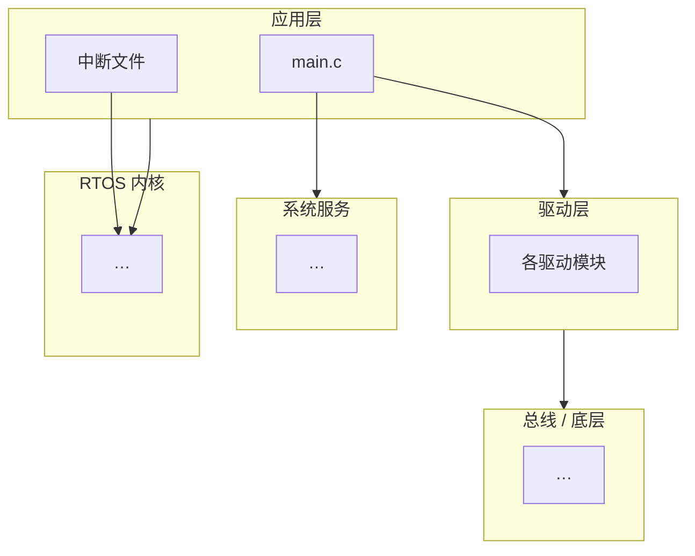
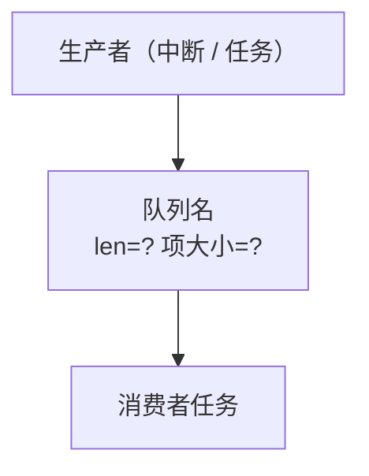

# 手环项目架构草案（architecture_draft）

> 生成：2026-09-22 ｜ 状态：**待填写** ｜ 核对节点：09-27（模块盘点日，限时半天）
> 用途：①第 3 周盘点的基线；②面试讲"任务划分与 IPC 设计"时的对照稿
> 填写原则：数据一律取自**项目代码实读**，不引用二手描述；写完一条就等于能讲一条。

---

## 目录

| 节 | 内容 | 主要取材 | 状态 |
|---|---|---|---|
| 1 | 项目概览 | 工程属性 / 目录规模 | ⬜ |
| 2 | 目录分层 | 各目录的职责与文件清单 | ⬜ |
| 3 | 任务清单 | `main.c` 任务创建处 | ⬜ |
| 4 | 队列清单 | `main.c` 队列创建处 ＋ 全项目收发搜索 | ⬜ |
| 5 | 模块调用关系图 | 综 2/3/4 节 | ⬜ |
| 6 | 初始化顺序 | `main()` 开头 | ⬜ |
| 7 | 界面切换的状态管理 | 各 Show 任务 ＋ 菜单任务 | ⬜ |
| 8 | 问题索引 | 代号表（见下方"外部索引"） | ⬜ |
| 9 | 待核对清单 | — | — |
| 10 | 面试可用段落 | 综全文 | ⬜ |

## 外部索引（本文件引用的其他资料）

| 资料 | 位置 | 用途 |
|---|---|---|
| B1-B4 / D1-D6 代号速查 | 《逐日任务清单》1.6 节 | 问题代号的定义与修复时点 |
| 问题清单逐条说明 | 主计划第八节 | 每条问题的位置、说明、归属 |
| `Docs/notes_rtos.md` | 本项目 | RTOS 机制与 `main.c` 精读记录 |
| `Docs/notes_baremetal.md` | 本项目 | 裸机专题（启动 / NVIC / 时钟 / GPIO / EXTI） |
| 项目源码 | `User/` `Hardware/` `System/` | 一切结论的唯一来源 |

---

## 1. 项目概览

| 项 | 值 |
|---|---|
| MCU 型号 / 启动文件 | |
| RTOS 与配置要点 | |
| 业务代码规模 | |
| 构建工具链 | |
| 顶层目录清单 | |

---

## 2. 目录分层

| 层 | 目录 | 职责 | 文件清单 |
|---|---|---|---|
| | | | |

**提示**：填完这一节，再回头看第 7 期计划的"精读"任务会轻松很多。

---

## 3. 任务清单

| # | 任务名 | 栈（单位?） | 优先级 | 职责 | 启动后初始状态 |
|---|---|---|---|---|---|
| | | | | | |

**自检问题**
- 一共几个任务？创建它们的那个任务自己算不算？
- 栈的单位是字还是字节？
- 优先级分布如何？是否分层？（对照 D1）
- 哪几个任务启动后立刻被挂起？为什么？

---

## 4. 队列清单

| # | 队列 | 长度 | 项大小 | 生产者（文件:行） | 消费者（文件:行） | 备注 |
|---|---|---|---|---|---|---|
| | | | | | | |

**自检问题**
- 每个队列的项大小与实际收发的数据类型**对得上吗**？（重点看结构体类的）
- 有没有跨中断的生产者？它的消费者在任务里还是中断里？
- 有没有多个消费者共用一个队列的情况？会有什么后果？
- 队列长度设为 1 的理由是什么？

---

## 5. 模块调用关系图

**要求**：至少两张图 —— ①分层依赖图；②任务 / 队列 / 中断的数据流图。

**图 1：分层依赖（模板，按实际增删节点）**

**图 2：数据流（模板）**

> 画图要点：生产者和消费者都要标**文件:行号**；跨中断的边单独标出来。

---

## 6. 初始化顺序

| 序 | 调用 | 作用 |
|---|---|---|
| | | |

**自检问题**：队列创建在任务创建之前还是之后？为什么这个顺序重要？

---

## 7. 界面切换的状态管理

**要写清三件事**：
1. 用什么机制切换界面（挂起/恢复？事件组？）
2. 退出信号从哪来、谁发出、谁接收
3. 这套机制有什么问题，怎么改（对照 D2）

---

## 8. 问题索引

| 代号 | 简述 | 位置（文件:行） | 归属任务 |
|---|---|---|---|
| | | | |

**本次实读新增（自行补充）**

| 编号 | 位置 | 说明 |
|---|---|---|
| | | |

> 编号请沿用你自己的体系（不要与 B/D 混用）—— **编号规则由你定**。

---

## 9. 待核对清单（09-27 盘点日逐条打勾）

- [ ] 任务数量、栈大小、优先级与代码一致
- [ ] 队列的生产者/消费者映射完整（有无遗漏的收发点）
- [ ] 关系图两张都与现实一致
- [ ] 补充：模块之间的**头文件依赖**（谁 include 谁）
- [ ] 补充：各模块对外接口清单（`xxx_init / read / deinit`）
- [ ] 完成后把本文件状态从"待填写"改为"已核对基线"
- [ ] 完成后更新第 3 周周检记录

---

## 10. 面试可用段落

**要求**：3–5 句话讲清"任务划分 + IPC 设计 + 我发现的坑"。
写完请**对着空气讲一遍**，讲不顺的地方说明还没吃透。

> （待填写）
