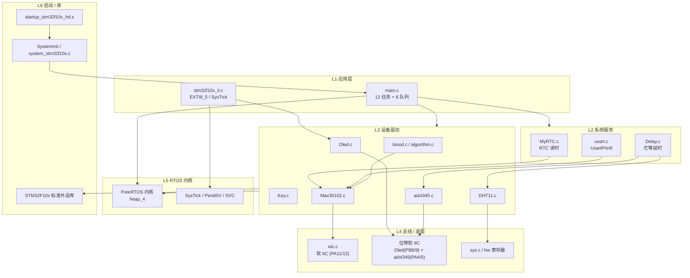
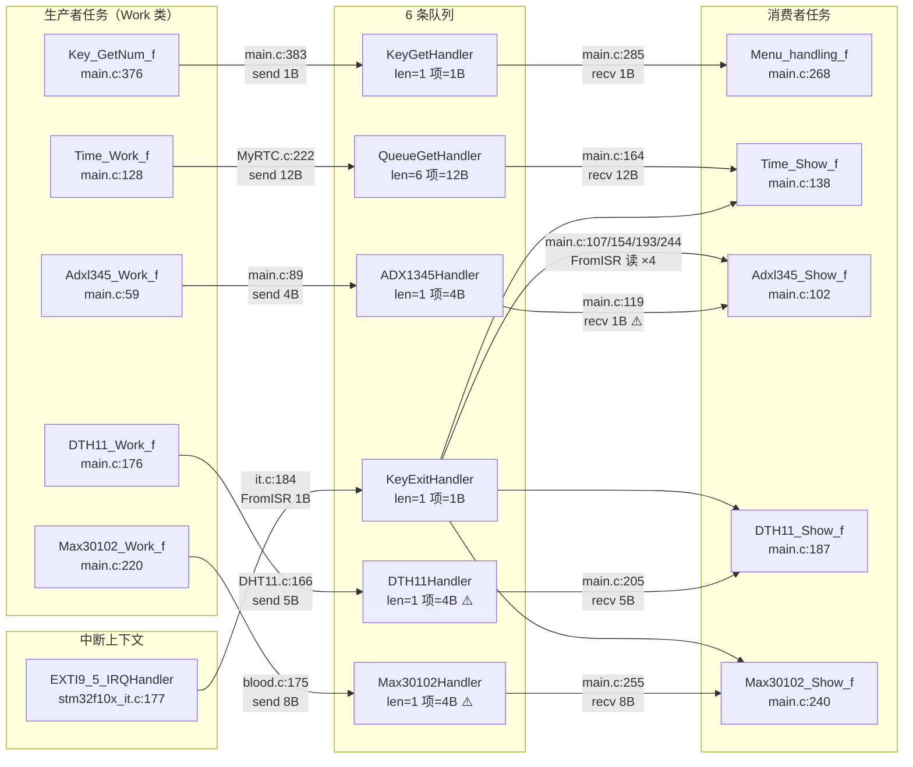

# 手环项目架构草案（architecture\_draft）

> 生成：2026-09-22 ｜ 状态：**待填写** ｜ 核对节点：09-27（模块盘点日，限时半天）
> 用途：①第 3 周盘点的基线；②面试讲"任务划分与 IPC 设计"时的对照稿
> 填写原则：数据一律取自**项目代码实读**，不引用二手描述；写完一条就等于能讲一条。

***

## 目录

| 节    | 内容        | 主要取材                     | 状态                    |
| ---- | --------- | ------------------------ | --------------------- |
| 1    | 项目概览      | 工程属性 / 目录规模              | 📝 已给逐行指引             |
| 2    | 目录分层      | 各目录的职责与文件清单              | 📝 已给逐行指引             |
| 3    | 任务清单      | `main.c` 任务创建处           | 📝 已给逐行指引（数据见附录 B）    |
| 4    | 队列清单      | `main.c` 队列创建处 ＋ 全项目收发搜索 | 📝 已给逐行指引（数据见附录 C）    |
| 5    | 模块调用关系图   | 综 2/3/4 节                | ✅ 已画（待你复核）            |
| 6    | 初始化顺序     | `main()` 开头              | 📝 已给逐行指引（数据见附录 D）    |
| 7    | 界面切换的状态管理 | 各 Show 任务 ＋ 菜单任务         | 📝 已给提纲 + 取材行号        |
| 8    | 问题索引      | 代号表（见下方"外部索引"）           | 📝 表 2 已给现成数据，表 1 待你填 |
| 9    | 待核对清单     | —                        | —                     |
| 10   | 面试可用段落    | 综全文                      | 📝 已给骨架 + 加分/避坑点      |
| A\~E | 附录：实读数据源  | 09-27 代码实读               | ✅ 已备齐                 |

> **图例**：⬜ 未开始 ｜ 📝 已给指引待你填写 ｜ ✅ 已完成（或已给现成内容）

## 外部索引（本文件引用的其他资料）

| 资料                        | 位置                            | 用途                                 |
| ------------------------- | ----------------------------- | ---------------------------------- |
| B1-B4 / D1-D6 代号速查        | 《逐日任务清单》1.6 节                 | 问题代号的定义与修复时点                       |
| 问题清单逐条说明                  | 主计划第八节                        | 每条问题的位置、说明、归属                      |
| `Docs/notes_rtos.md`      | 本项目                           | RTOS 机制与 `main.c` 精读记录             |
| `Docs/notes_baremetal.md` | 本项目                           | 裸机专题（启动 / NVIC / 时钟 / GPIO / EXTI） |
| `Docs/map_guide.md`       | 本项目                           | map 文件速查（符号定位 / 容量核算 / 段名对照）       |
| `Listings/手环项目.map`       | 本项目                           | 链接映射原始文件（Flash 53% / RAM 84%）      |
| 项目源码                      | `User/` `Hardware/` `System/` | 一切结论的唯一来源                          |

***

## 1. 项目概览

| 项             | 值                                                                                                                                                 | 从哪取（★ 已实读核对）                                                                                                                                                                                                                                                                                                |
| ------------- | ------------------------------------------------------------------------------------------------------------------------------------------------- | ----------------------------------------------------------------------------------------------------------------------------------------------------------------------------------------------------------------------------------------------------------------------------------------------------------- |
| MCU 型号 / 启动文件 | Device:STM32F103C8\$Flash\STM32F10x\_128.FLM\*\*  \*\*<PathWithFileName>.\Start\startup\_stm32f10x\_md.s</PathWithFileName>                       | ① 型号：`手环项目.uvprojx` 的 `<Device>` → **STM32F103C8**② 启动文件：同一文件里 `<FileName>` 中的 `.s` → **`startup_stm32f10x_md.s`**⚠️ **别写** **`hd.s`**，见下方"填写陷阱 1"                                                                                                                                                          |
| RTOS 与配置要点    | 1.使用协作式调度（时间片轮转）2.使能时间片调度3.不使用软件定时器。不使能空间任务钩子。设置最大堆栈尺寸为10kb，配置系统最高可管理优先级为5.                                                                       | `FreeRTOS/FreeRTOSConfig.h`。**只写 4\~6 条要点**，全部已核对：`configUSE_PREEMPTION=0`（协作式！）／`configUSE_TIME_SLICING=1`／`configUSE_TIMERS=0`／`configUSE_IDLE_HOOK=0`／`configTOTAL_HEAP_SIZE=10KB`／`configLIBRARY_MAX_SYSCALL_INTERRUPT_PRIORITY=5`写法建议：`FreeRTOS v? / heap_4 / 抢占=0（协作） / 时片=1 / 堆=10KB / SysCall 门限=5` |
| 业务代码规模        | **整工程：33.86kB（Total RO = 34676B，map L3589）／三四十个文件；自研代码口径待按段统计**                                                                                   | ⚠️ **33.86kB 是"整工程"Total RO Size（含标准库/FreeRTOS 内核），不是"只统计自己写的"**。若只要自研（`User/`＋`Hardware/`＋`System/`），需按 .map 里各目标段累计——建议填"文件数 / 总行数"两个数。数值出处：`Listings/手环项目.map` L3589（Total RO 34676B）、L3590（Total RW 17312B）                                                                                             |
| 构建工具链         | **Keil MDK / ARMCC V5.06 update 7 (build 960) / -O1**                                                                                             | `手环项目.uvprojx`：`<ToolsetNumber>`=0x4 → Keil MDK（L11）；`<pCCUsed>`=ARMCC V5.06u7（L13）；`<Optim>`=1 → -O1（L316）。写法建议：`Keil MDK / ARMCC V5.06u7 / -O1`                                                                                                                                                           |
| 顶层目录清单        | **排除**`.git` `.vscode` `build` `Objects` `Listings` 这类产物目录核心 6 个：`User/` `Hardware/` `System/` `Start/` `LIbrary/` `FreeRTOS/`（另有 `app/` `Docs/`） | 项目根 `ls` 结果里**排除** `.git` `.vscode` `build` `Objects` `Listings` 这类产物目录核心 6 个：`User/` `Hardware/` `System/` `Start/` `LIbrary/` `FreeRTOS/`（另有 `app/` `Docs/`）                                                                                                                                              |

 

 

**填写陷阱 1（★ 必看 · ✅ 2026-10-05 已闭环）**：工程实际编译的是 **`startup_stm32f10x_md.s`（307 行 / 向量表 59 项）**，
而 `Docs/notes_baremetal.md` 早期记的行号（L56-142 向量表、L147-155 Reset\_Handler、L151-152 调 SystemInit）
**全部是** **`hd.s`** **的行号（358 行 / 76 项）**。两个文件在 `Start/` 下并存，容易混。
→ **`notes_baremetal.md`** **第 1 节行号已于 10-05 全部替换为** **`md.s`** **实测值**；依据见下方"附录 A"。

**填写陷阱 2**：`configUSE_PREEMPTION = 0` 是**协作式**（非抢占）。这一条影响你对第 3、7 节的解释口吻，
面试被问到时**主动说出来**是个加分点（"我这个工程其实跑的是协作式调度"）。

***

## 2. 目录分层

<!-- 逐行指引：一行 = 一个目录。文件清单只写"业务文件"，标准库整目录一笔带过即可 -->

<!-- 表头"层"这一列，就是第 5 节图 1 里的 L1~L6，两边要一致 -->

| 层      | 目录     | 职责     | 文件清单   |
| ------ | ------ | ------ | ------ |
| L1 应用 | `User/` | 主流程：初始化、12 个任务函数、中断服务函数 | `main.c`、`stm32f10x_it.c`（`stm32f10x_it.h` `stm32f10x_conf.h` 为配置头，可略） |
| L2 系统服务 | `System/` | 与芯片外设强相关的服务：延时、RTC | `Delay.c`、`MyRTC.c`、`sys.c` |
| L3 设备驱动 | `Hardware/` | 各外设驱动 + 算法 | `Oled.c` `Key.c` `adxl345.c` `DHT11.c` `Max30102.c` `blood.c` `algorithm.c` `usart.c` `xiic.c` `Led.c`（10 个 .c） |
| L4 启动 | `Start/` | 启动文件、内核启动、系统时钟初始化 | `startup_stm32f10x_md.s`（实测编译项）、`system_stm32f10x.c`、`core_cm3.c` |
| L5 RTOS | `FreeRTOS/` | 内核源码与配置 | `FreeRTOSConfig.h` ＋ `tasks.c` `queue.c` `list.c` `port.c` `heap_4.c` |
| L6 库 | `LIbrary/` | STM32F10x 标准外设库（厂商代码，非自研） | 整目录，**写"标准外设库（厂商提供）"即可，不用列文件** |

**逐行填写指引（照这个顺序抄，6 行）**

| 建议的"层"  | 目录          | 职责怎么写                     | 文件清单                                                                                                   |
| ------- | ----------- | ------------------------- | ------------------------------------------------------------------------------------------------------ |
| L1 应用   | `User/`     | 主流程：初始化、12 个任务函数、中断服务函数   | `main.c`、`stm32f10x_it.c`、                                                                             |
| L2 系统服务 | `System/`   | 与芯片外设强相关的服务：延时、RTC        | `Delay.c`、`MyRTC.c`、`sys.c`                                                                            |
| L3 设备驱动 | `Hardware/` | 各外设驱动 + 算法                | `Oled.c` `Key.c` `adxl345.c` `DHT11.c` `Max30102.c` `blood.c` `algorithm.c` `usart.c` `xiic.c` `Led.c` |
| L4 启动   | `Start/`    | 启动文件、内核启动、系统时钟初始化         | `startup_stm32f10x_md.s`、`system_stm32f10x.c`、`core_cm3.c`                                             |
| L5 RTOS | `FreeRTOS/` | 内核源码与配置                   | `FreeRTOSConfig.h` ＋ `tasks.c` `queue.c` `list.c` `port.c` `heap_4.c`                                  |
| L6 库    | `LIbrary/`  | STM32F10x 标准外设库（厂商代码，非自研） | 整目录，**写"标准外设库（厂商提供）"即可，不用列文件**                                                                         |

**这一节的自检（填完回看）**

- [ ] 6 行的"层"编号是否和第 5 节图 1 的 `L1`\~`L6` **完全一一对应**？（对不上，图就得改）
- [ ] `Hardware/` 我列了 10 个文件，你数一下实际是不是 10 个 `.c`（`.h` 和 `Oled_Font.h` 我归入同层未单列）
- [ ] 标准库那一行**没有**把 40+ 个 `stm32f10x_*.c` 逐一列出吧？（列出了就太啰嗦）

**提示**：填完这一节，再回头看第 7 期计划的"精读"任务会轻松很多。

***

## 3. 任务清单

<!-- 逐行指引：12 行。前 4 列直接抄附录 B，第 5 列"职责"要你自己写（一句话） -->

| #  | 任务名    | 栈(word) | 优先级    | 职责（★ 你来写） | 启动后初始状态 |
| -- | ------ | ------ | ------ | --------- | ------- |
| —  | `Start_MyTaskList` | 128 | 2 | 启动任务：创建其余 11 个任务后自删 | 建完自删 |
| 1  | `Time_Work_f` | 128 | 4 | 周期读 RTC（1s）并写显示数据供队列 | 运行 |
| 2  | `Time_Show_f` | 128 | 4 | 时间/日期页面渲染；支持时间修改 | **挂起** |
| 3  | `Adxl345_Work_f` | 128 | 4 | 加速度采样 + 计步/跌倒检测，产步数投队列 | 运行 |
| 4  | `Adxl345_Show_f` | 128 | 4 | 步数页面渲染 | **挂起** |
| 5  | `DTH11_Work_f` | 224 | 4 | 温湿度采样（100ms 周期）并投队列 | 运行 |
| 6  | `DTH11_Show_f` | 224 | 4 | 温湿度页面渲染 | **挂起** |
| 7  | `Max30102_Work_f` | 224 | 4 | 血氧/心率 FIFO 采集（128 点）＋算法运算 | 运行 |
| 8  | `Max30102_Show_f` | 224 | 4 | 血氧/心率页面渲染 | **挂起** |
| 9  | `Menu_handling_f` | 128 | 4 | 菜单状态机：响应按键/蓝牙选择，调度各页面 | 运行 |
| 10 | `Key_GetNum_f` | 128 | 4 | 按键扫描，产键值投队列 | 运行 |
| 11 | `beep_Work_f` | 128 | 4 | 跌倒报警：串口/OLED/蜂鸣器翻转 | **挂起** |
| 12 | `Idle`（内核） | `configMINIMAL_STACK_SIZE` | 0 | 空闲任务（内核自动创建） | 运行 |

**自检问题（★ 用你自己的话回答，写在表下方）**

1. **一共几个任务？创建它们的那个任务自己算不算？**
   —— 用户代码创建 **12 个**（11 个业务任务 + `Start_MyTaskList`）；加上内核自动建的 **Idle** 共 13 个。口径：**算上 Start、算上 Idle**，共 13 个；若只算"业务任务"则 11 个。`configUSE_TIMERS=0` 所以**没有 Timer 任务**。
2. **栈的单位是字还是字节？**
   —— 单位是**字（word）**，1 word = 4 B。所以表里 128 实际是 **512 B**、224 实际是 **896 B**。栈合计（实测）：**12 个用户任务（含 Start）= 1920 word = 7680 B**；11 个业务任务（不含 Start）= **1792 word = 7168 B**（均不含内核 Idle）。
3. **优先级分布如何？是否分层？（对照 D1）**
   —— **全 4，只有一个层次**，只有 `Start` 是 2。业务任务全部同一优先级 → 依赖**时间片轮转**（`configUSE_TIME_SLICING=1`）；这也正是协作式调度下"谁都不抢占谁"的表现。对应问题代号 **D1**。
4. **哪几个任务启动后立刻被挂起？为什么？**
   —— **5 个**：4 个 Show（Time/Adxl345/DTH11/Max30102_Show）＋ `beep_Work_f`，在 `Start_MyTaskList` 末尾（L424-428）`vTaskSuspend`。为什么 → **省调度开销 / 由菜单按需唤醒**（平时不渲染，进对应页面才恢复）。

**逐行填写指引**

- **栈这一列**：填数字即可，但**表头"单位?"你要自己改成"栈(word)"**——
  这是你自己设计的一个考点，说明你已经知道 `xTaskCreate` 的栈单位是**字**（1 word = 4 B）。
- **"职责"列的写法**：不要写"读取 DHT11 数据"这种废话，写**它在系统里的角色**。对照示例：

| 任务                 | 职责可以这样写（★ 参考，请改写为你自己的话） |
| ------------------ | ----------------------- |
| `Time_Work_f`      | 周期读 RTC 并投递到显示队列        |
| `Time_Show_f`      | 时间页面渲染；被挂起，进菜单时恢复       |
| `Adxl345_Work_f`   | 加速度采样 + 计步测算，产出步数投队列    |
| `Adxl345_Show_f`   | 步数页面渲染                  |
| `DTH11_Work_f`     | 温湿度采样并投队列               |
| `DTH11_Show_f`     | 温湿度页面渲染                 |
| `Max30102_Work_f`  | 心率的 FIFO 采集 + 算法运算      |
| `Max30102_Show_f`  | 血氧/心率页面渲染               |
| `Menu_handling_f`  | 菜单状态机：响应按键/蓝牙选择，调度各页面   |
| `Key_GetNum_f`     | 按键扫描，产出键值投队列            |
| `beep_Work_f`      | 跌倒报警（蜂鸣器翻转）；平时挂起        |
| `Start_MyTaskList` | 启动任务：创建上述 11 个任务后自删     |

- **完整数据（直接抄）**：见 **附录 B**（任务名 / 栈 / 优先级 / 状态 / 创建行号 全都有）

**自检问题（★ 请用你自己的话回答，写在表下方）**

1. 一共几个任务？创建它们的那个任务自己算不算？
   ——提示：内核还会自动建 `Idle` 任务（`configUSE_TIMERS=0` 所以**没有** Timer 任务）。你要定一个口径并说明。
2. 栈的单位是字还是字节？——**已在表头体现，这里补一句"所以 128 实际是 512 B"**
3. 优先级分布如何？是否分层？（对照 D1）
   ——提示：**全 4，只有一个层次**，只有 `Start` 是 2。这一条对应问题代号 **D1**
4. 哪几个任务启动后立刻被挂起？为什么？
   ——提示：**5 个**（4 个 Show ＋ beep），在 `Start_MyTaskList` 末尾 `vTaskSuspend`。为什么 → **为了省调度开销 / 由菜单按需唤醒**

***

## 4. 队列清单

<!-- 逐行指引：6 行，全部可直接抄附录 C。这一节的"备注"列是关键，别空着 -->

| # | 队列     | 长度     | 项大小    | 生产者（文件:行） | 消费者（文件:行） | 备注     |
| - | ------ | ------ | ------ | --------- | --------- | ------ |
| 1 | `QueueGetHandler` | 6 | 12B | `MyRTC.c:222`（Time_Work_f 周期投递） | `main.c:164`（Time_Show_f） | 项大小 = `uint16_t[6]`，收发一致；`len=6` 容纳一次完整时间数组（年/月/日/时/分/秒） |
| 2 | `KeyGetHandler` | 1 | 1B | `main.c:383`（Key_GetNum_f） | `main.c:285`（Menu_handling_f） | `len=1` + 阻塞发送（`portMAX_DELAY`）成立的前提是**只有一个生产者**（无竞争） |
| 3 | `KeyExitHandler` | 1 | 1B | **`stm32f10x_it.c:184`（EXTI9_5 ISR，跨中断）** | `main.c:107/154/193/244`（4 个 Show 任务） | ⚠️ **跨中断**：ISR 发、任务收；但 4 个接收全用了 `xQueueReceiveFromISR`（任务里用 FromISR 属 API 误用）；且 4 抢 1，只有 1 个能拿到 |
| 4 | `ADX1345Handler` | 1 | 4B | `main.c:89`（发 `uint32_t Normal_num`） | `main.c:119`（收 1B `uint8_t`） | ⚠️ **发 `uint32_t` 收 `uint8_t` → P0-3 栈越界** |
| 5 | `DTH11Handler` | 1 | 4B | `DHT11.c:166`（发 5B `DHT11_Data_TypeDef`） | `main.c:205`（收 5B 结构体） | ⚠️ 创建时项大小写成了 `sizeof(指针)`=4B，实际发 5B 结构体 → **P0-1 堆破坏** |
| 6 | `Max30102Handler` | 1 | 4B | `blood.c:175`（发 8B `BloodData`） | `main.c:255`（收 8B） | ⚠️ 同上，项大小 4B 但发 8B → **P0-2 堆破坏** |

**自检问题（★ 用你自己的话回答）**

1. **每个队列的项大小与实际收发的数据类型对得上吗？**
   —— **3 个对不上**：1、2、3 号对得上；**4、5、6 号对不上**（4 号发 4B 收 1B、5/6 号创建为指针大小 4B 却发 5B/8B 结构体）。这是**全项目最重的一类 bug**（P0 级）。
2. **有没有跨中断的生产者？它的消费者在任务里还是中断里？**
   —— **只有 `KeyExitHandler` 一个**，生产者来自 `EXTI9_5_IRQHandler`（中断）；消费者是 **4 个任务**（任务里收，**不该用 FromISR**）。
3. **有没有多个消费者共用一个队列的情况？会有什么后果？**
   —— **有，`KeyExitHandler` 有 4 个消费者任务**。后果：**谁先醒谁拿到，其余拿不到**（队列是"取走即消失"）；而且 4 个都用 `FromISR` 读，本身已是 API 误用。**这是 D2 的一个真实缺陷**。
4. **队列长度设为 1 的理由是什么？**
   —— 设计意图大概是"最新值覆盖 + 省 RAM"，但**代码实现是"满了就丢"而不是"覆盖"**（没有用 `xQueueOverwrite`）。这一问正好把 **P2-11（队列满静默丢步）** 引出来。

**逐行填写指引**

- **"备注"列必须写东西**，这是这一节的价值所在。建议这样写：

| # | 队列                | 备注（★ 参考形态，请自己判断后再写）                                 |
| - | ----------------- | --------------------------------------------------- |
| 1 | `QueueGetHandler` | 项大小 12B = `uint16_t[6]`，收发一致；`len=6` 是为了容纳一次完整时间数组  |
| 2 | `KeyGetHandler`   | `len=1` + 阻塞发送（`portMAX_DELAY`）成立的前提是**只有一个生产者**    |
| 3 | `KeyExitHandler`  | **跨中断**：ISR 发、4 个任务收；⚠️ 但 4 个接收全用了 `FromISR` 版本     |
| 4 | `ADX1345Handler`  | ⚠️ 发 `uint32_t` 收 `uint8_t` → **P0-3 栈越界**          |
| 5 | `DTH11Handler`    | ⚠️ 项大小写成了 `sizeof(指针)`=4B，实际发 5B 结构体 → **P0-1 堆破坏** |
| 6 | `Max30102Handler` | ⚠️ 同上，项大小 4B 但发 8B `BloodData` → **P0-2 堆破坏**       |

- **完整数据（直接抄）**：见 **附录 C**（含每个收发点的 `文件:行号`）

**自检问题（★ 请用你自己的话回答）**

1. 每个队列的项大小与实际收发的数据类型**对得上吗**？
   ——提示：**3 个对不上**（1、2 号对得上；4、5、6 号对不上）。这是**全项目最重的一类 bug**。
2. 有没有跨中断的生产者？它的消费者在任务里还是中断里？
   ——提示：**只有** **`KeyExitHandler`** **一个**，来自 `EXTI9_5_IRQHandler`；消费者是**任务**（所以消费者不该用 `FromISR`）
3. 有没有多个消费者共用一个队列的情况？会有什么后果？
   ——提示：**有，`KeyExitHandler`** **有 4 个消费者任务**。后果：**谁先醒谁拿到，其余拿不到**（队列是"取走即消失"）；
   而且 4 个都用 `FromISR` 读，本身已是 API 误用。**这是 D2 的一个真实缺陷**
4. 队列长度设为 1 的理由是什么？
   ——提示：设计意图大概是"最新值覆盖 + 省 RAM"，但**代码实现是"满了就丢"而不是"覆盖"**（没有用 `xQueueOverwrite`）。
   这一问正好把 **P2-11（队列满静默丢步）** 引出来。

***

## 5. 模块调用关系图

> **填写：2026-09-27 盘点日实读代码产出**（数据源 = `User/` `Hardware/` `System/` 源码）
> 状态：图已画，**待你对照代码复核**

### 图 1：分层依赖图

**读图要点（面试可直接讲）**

- `L1` 两个文件是**唯一**能创建任务/队列的地方（`main.c`）/ 唯一从中断发消息的地方（`it.c`）
- `L3` 里 **Oled.c 与 adxl345.c 各带一套私有位带软 IIC**，`Max30102` 走 `xiic.c` —— 三套并存是 **P2-12** 的图面证据
- `C3 → D3/D4` 是**忙等延时**的传播路径（Delay 被驱动层直接调用）

### 图 2：DATA 流（任务 / 队列 / 中断）

**⚠️ 三处项大小不匹配（图中已标）**

| 队列                | 创建时项大小           | 实际收发             | 后果        | 对应       |
| ----------------- | ---------------- | ---------------- | --------- | -------- |
| `DTH11Handler`    | 4B（`sizeof(指针)`） | 发 5B 结构体         | 每次多写 1B 堆 | **P0-1** |
| `Max30102Handler` | 4B（`sizeof(指针)`） | 发 8B `BloodData` | 每次多写 4B 堆 | **P0-2** |
| `ADX1345Handler`  | 4B               | 发 4B / 收 1B      | 栈上多写 3B   | **P0-3** |

**⚠️ 一处跨上下文使用错误**
`KeyExitHandler` 的消费者是 **4 个任务**，却在任务里用 `xQueueReceiveFromISR` 读（`main.c:107/154/193/244`）——
`FromISR` 版本**只能在中断里调用**，在任务里调属 API 误用（且 4 个任务同时抢同一队列，谁先醒谁清标志）。

***

## 6. 初始化顺序

<!-- 逐行指引：14 行，直接抄附录 D。抄完只需补一段"为什么这个顺序" -->

| 序  | 调用     | 作用     |
| -- | ------ | ------ |
| 1  | `OLED_Init()` | 初始化 OLED 软件 IIC 引脚（PB8/PB9）与显示参数 |
| 2  | `MyRTC_Init()` | 初始化 RTC 外设与时基 |
| 3  | `Key_Init()` | 初始化按键 GPIO（PB13/14/15 下拉输入 + PB1/PB12 推挽输出 + AFIO 时钟） |
| 4  | `Usart1_Init(115200)` | 初始化 USART1（PA9/PA10 复用），115200 波特，开 RX 中断 |
| 5  | `EXTI8_Config()` | 配置 PA8 上升沿中断 + NVIC（EXTI9_5_IRQn） |
| 6  | `Init_ADXL345()` | 初始化加速度计（走软 IIC PA11/12） |
| 7  | `DHT11_GPIO_Config()` | 初始化温湿度单总线 GPIO（PA7） |
| 8  | `IIC_GPIO_INIT()` | 初始化软 IIC 引脚（PA11/PA12，开漏输出）——MAX30102/ADXL345 共用总线 |
| 9  | `MAX30102_GPIO()` | 初始化血氧模块 GPIO（PA6 INT 浮空输入） |
| 10 | `Max30102_reset()` | 软复位 MAX30102 |
| 11 | `MAX30102_Config()` | 配置 MAX30102 工作参数（FIFO/采样率/LED 电流） |
| 12 | 6 × `xQueueCreate` | 建 6 条队列（L455-460） |
| 13 | `xTaskCreate(Start_MyTaskList)` | 建启动任务（L462），由它再建其余 11 个任务 |
| 14 | `vTaskStartScheduler()` | 启动调度器，不再返回（L465） |

**顺序要点**：队列（序 12）**先于**任务（序 13）创建——因为调度器启动（序 14）后任务一跑就可能 `xQueueSend/Receive`，若句柄还是 NULL 就是操作空句柄 → 未定义行为。更严格的说法：关键是"队列必须在 `vTaskStartScheduler()` 之前建好"。另外第 8~11 行的因果链：`IIC_GPIO_INIT()`（软 IIC 引脚）排在 `MAX30102_GPIO()` 之前，因为 MAX30102 走的就是那条软 IIC 总线。

**逐行填写指引**

- 数据见 **附录 D**（14 行完整）。"作用"一列**别写空话**，写它初始化了什么：
  例如 `OLED_Init()` → "初始化 OLED 的软件 IIC 引脚与显示参数"，而不是"初始化 OLED"。
- **注意第 8\~11 行的顺序有讲究**：`IIC_GPIO_INIT()`（软 IIC 引脚）排在 `MAX30102_GPIO()` 之前，
  因为 MAX30102 走的就是那条软 IIC 总线。**这个因果链值得你在"作用"列或备注里点出来。**

**自检问题（★ 请用你自己的话回答）**：队列创建在任务创建之前还是之后？为什么这个顺序重要？
—— 参考答案方向（请你改写）：队列在**前**（L455-460），任务在**后**（L462）。
原因：任务一旦被调度就可能立刻 `xQueueSend/Receive`，此时队列句柄若还是 `NULL`，属于对空句柄操作 → 未定义行为。
**更严格的说法**：关键是"队列必须在 `vTaskStartScheduler()`（L465）之前建好"，
因为调度器没启动前任务根本不会跑，所以"队列先于任务"其实是"队列先于调度器"的推论。

***

## 7. 界面切换的状态管理

<!-- 逐行指引：这节没有表格，是三个小问。我给你"取材行号 + 骨架"，内容你自己写 -->

### 7.1 用什么机制切换界面？

- **取材**：`main.c` 的 `Menu_handling_f`（L268-374），重点看 `switch(operate)` 里那 4 个 `case`（L327-350）
- **你要在代码里找到并写出**：
  - 切换动作 = `vTaskResume(某个Show任务)` ＋ `vTaskSuspend(Key_GetNum_fHandler)` ＋ `vTaskSuspend(NULL)`（L330-331 等 4 处）
  - 即：**挂起/恢复机制**（不是事件组、不是状态机标志位）
  - **笔顺提示**：先写"机制是挂起恢复"，再写"谁挂起谁、谁恢复谁"，一句话一行
- **写完后自查**：`taskENTER_CRITICAL()` / `taskEXIT_CRITICAL()` 包住了这些调用（L329-331）——**为什么需要包？**
  （提示：怕挂起动作被中断打断，导致"恢复了 A 却没挂起 B"的中间态。这是你自己的代码里罕见的**正确做法**，值得写进去）

**✓ 已填写：**

**切换机制 = 挂起/恢复（task 状态机），不是事件组/标志位。** 触发源有两个：蓝牙（`switch(rxBuffer)`，L288-321）和按键（`switch(operate)`，L327-350），两套逻辑做的都是同一件事：

- **谁恢复谁**：`Menu_handling_f` 自己把 `vTaskResume(对应 Show 任务)`（如 case 1 → `Time_Show_fHandler`）
- **谁挂起谁**：同时 `vTaskSuspend(Key_GetNum_fHandler)`（暂停按键扫描，防止在页面里误切）＋ `vTaskSuspend(NULL)`（把自己挂起，让出 CPU 给 Show 任务）
- **为什么用 `taskENTER_CRITICAL()` 包住**：恢复/挂起是"多步状态变更"，若被中断打断可能停在"恢复了 A 却没挂起 B"的中间态；临界区保证切换动作原子完成。

### 7.2 退出信号从哪来、谁发出、谁接收？

- **取材**：`EXTI9_5_IRQHandler`（`stm32f10x_it.c` L177-189）→ 发 `KeyExitHandler` 队列
- **你要写清三条链**：
  1. **谁来**：PA8 引脚上升沿（物理按键）
  2. **谁发**：`EXTI9_5_IRQHandler` 里 `xQueueSendFromISR(KeyExitHandler, &KeyExit, NULL)`（L184）
  3. **谁收**：4 个 Show 任务各自 `xQueueReceiveFromISR`（L107/154/193/244）→ 触发 `vTaskResume(Menu…)` 等
- **注意一个细节**：退出后 `KeyExit_R = 0; global_var = 0;` 的**清零动作在任务里**（L111 等）
- **写完后自查**：4 个任务抢同一个 `len=1` 队列 → **只有一个会拿到值**，其余三个收不到退出信号。
  那它们是怎么退出的？→ 看 `global_var==1` 这个条件（L108/155/194/245），**这才是真正兜底的退出路径**。
  **这一段如果你自己讲清楚了，面试时是个亮点**（说明你理解"为什么还需要 global_var 兜底"）

**✓ 已填写：**

| 链 | 内容 |
| --- | --- |
| 谁来 | PA8 上升沿（物理按键按下）→ `EXTI9_5_IRQHandler` |
| 谁发 | ISR 里 `xQueueSendFromISR(KeyExitHandler, &KeyExit, NULL)`（it.c L184） |
| 谁收 | 4 个 Show 任务各 `xQueueReceiveFromISR(KeyExitHandler,…)`（main.c L107/154/193/244）→ 收到后恢复菜单、挂起自己 |

- **清零细节**：`KeyExit_R = 0; global_var = 0;` 在**任务里**执行（L111 等），ISR 不清。
- **为什么需要 `global_var` 兜底**：4 个任务抢 `len=1` 队列，**只有 1 个能拿到退出值**，其余 3 个收不到 → 它们靠 `global_var==1` 这个共享标志**也能退出**。即：队列是"快路径"，`global_var` 是"兜底路径"，两条路径保证 4 个页面都能退出。（代价：无保护全局标志 + 重复代码，见 7.3）

### 7.3 这套机制有什么问题，怎么改？（对照 D2）

- **问题清单（取材自你自己的判断，下面只是提示方向）**：
  - ① 4 个任务收同一条消息 → **消息只被消费一次**，靠 `global_var` 兜底，耦合
  - ② **在任务里用** **`xQueueReceiveFromISR`**（API 误用，见第 5 节）
  - ③ `global_var` 是无保护的全局标志，任务写、多个任务读
  - ④ 退出路径在 4 个任务里各写一遍（**重复代码**，一处改动要改 4 处）
- **改法方向（自己写，别照抄）**：用**事件组**（`xEventGroupSetBits` 广播）/ 或改成一个**统一的状态机任务** / 或让退出只由 `Menu_handling_f` 一个人接收，再分发给 Show 任务
- **写完后自查**：你的改法是否解决了"一个消息多个消费者"这个根本冲突？

**✓ 已填写：**

**问题**：
1. **单消费者语义**：`KeyExitHandler` 是 `len=1` 队列，"取走即消失"，4 个任务抢 → 只有 1 个拿到，靠 `global_var` 兜底 → 队列形同虚设、耦合高。
2. **API 误用**：任务里调 `xQueueReceiveFromISR`（只能用于中断上下文）。
3. **无保护全局变量**：`global_var` 任务写、多任务读，无原子保护。
4. **重复代码**：退出处理在 4 个 Show 任务各写一遍（L107-117/154-158/193-203/244-254），改一处要改 4 处。

**改法方向**：改用**事件组**——ISR 里 `xEventGroupSetBitsFromISR` 广播"退出"位，4 个任务各自 `xEventGroupWaitBits` 监听，一次广播全部收到，天然解决"多消费者"；`global_var` 可删除；退出处理收敛进一个函数或统一由 `Menu_handling_f` 接收后再分发。**自查**：事件组方案解决了"一个消息多个消费者"的根本冲突。

***

## 8. 问题索引

<!-- 逐行指引：两张表。第一张抄"外部代号"，第二张是你本次实读新发现的（已给你现成的） -->

**表 1：外部代号（B/D 系列）**

- **取材**：《逐日任务清单》1.6 节 ＋ 主计划第八节。**这两份资料我手上没有**，所以这张表**只能你来填**。
- **要填的代号**（从我们这几周的对话里能确定存在的）：**B1 / B2 / B4 / D1 / D2**
- 填法：每个代号一行，写"简述 + 位置 + 归属任务"。例如 B2 那一行大概是：
  `B2 | EXTI8 抢占优先级 0 却调 FromISR，竞态 | Key.c:74 + it.c:184 | Menu/Show 组`
- **⚠️ 提醒**：`B3`、`D3~D6` 我不确定你定义过没有 —— **如果《逐日任务清单》里没有，就是空号，别硬凑**。

**表 2：本次实读新增**

- **直接抄下方内容**（这是 09-27 盘点日从代码里读出来的，已在 `notes_rtos.md` 里落成 P2-16/17、P1-15、P0-4/5）：

| 编号        | 位置                                | 说明                                       |
| --------- | --------------------------------- | ---------------------------------------- |
| **P0-4**  | `Key.c:74` + `stm32f10x_it.c:184` | EXTI8 抢占优先级 0 却调 `FromISR` → **B2 竞态成因** |
| **P0-5**  | `stm32f10x_it.c:177-189`          | ISR 里做 OLED 重活（软 IIC 阻塞）+ 清 pending 放最后  |
| **P1-15** | `Hardware/Key.c:89-110`           | `Key_GetNum()` 自旋等松手，无 yield/超时          |
| **P2-16** | `main.c` 7 处                      | `OLED_Clear()` 每轮循环调用，毫秒级阻塞              |
| **P2-17** | `main.c:62,71`                    | "软件定时器"实际周期可达数十秒（P1-1 加重版）               |

> 编号请沿用你自己的体系（不要与 B/D 混用）—— **编号规则由你定**。
> **⚠️ 我的编号是"沿用 original 笔记的 P 级体系"**（P0-4 表示 notes\_rtos.md 里 P0 段的第 4 条）。
> 如果你的《逐日任务清单》另有体系，**请替换成你自己的编号**。

***

## 9. 待核对清单（09-27 盘点日逐条打勾）

- [x] 任务数量、栈大小、优先级与代码一致 → **12 任务（含 Start）／栈合计 1920 word 含 Start（业务任务 1792 word）／全 4（Start 为 2）**（09-27 实读抽取，见附录）
- [x] 队列的生产者/消费者映射完整（有无遗漏的收发点）→ **6 队列 / 收发点已全量搜索**（见第 5 节图 2）
- [x] 关系图两张都与现实一致 → **已画**（待你复核）
- [ ] 补充：模块之间的**头文件依赖**（谁 include 谁）
- [ ] 补充：各模块对外接口清单（`xxx_init / read / deinit`）
- [ ] 完成后把本文件状态从"待填写"改为"已核对基线"
- [ ] 完成后更新第 3 周周检记录

***

## 9.1 盘点日实读抽取 → 已移至文末「附录」

第 1/3/4/6 节要引用的原始数据（任务清单 / 队列清单 / 初始化顺序），
统一放在**文末附录 A\~E**，便于从各节"逐行指引"直接对照抄写，不在正文重复。

***

## 10. 面试可用段落

<!-- 逐行指引：这段必须你自己写。写之前先把 1~9 节填完 -->

**要求**：3–5 句话讲清"任务划分 + IPC 设计 + 我发现的坑"。
写完请**对着空气讲一遍**，讲不顺的地方说明还没吃透。

**骨架指引（只给结构，词句全部你自己写）**

| 句     | 要讲什么                   | 素材来源                                  |
| ----- | ---------------------- | ------------------------------------- |
| 第 1 句 | 项目是什么 + 规模             | 第 1 节（MCU / RTOS / 任务数）               |
| 第 2 句 | 任务怎么划分的（为什么这么分）        | 第 3 节（12 任务 / Work-Show 成对 / 全 4 优先级） |
| 第 3 句 | IPC 怎么设计的（队列几个、为什么用队列） | 第 4 节（6 队列 / 1 个跨中断）                  |
| 第 4 句 | 我在哪发现过 bug、怎么定位的       | 第 8 节（**只挑 1\~2 个讲透**，不要罗列 38 条）      |
| 第 5 句 | 如果重做，我会怎么改             | 第 7 节 7.3 ＋ 第 8 节                     |

**★ 讲这题的三个加分点（面试官爱听的）**

1. **主动说出是协作式（`configUSE_PREEMPTION=0`）** —— 大多数人只会说"我用了 FreeRTOS"，说不出调度配置
2. **说清一个 bug 的完整定位链**（如 P0-1 堆破坏：项大小写错 → 每 100ms 多写 1B → 随机死机难排查）
3. **说清"我发现了问题但没修"** —— 诚实且显示你能判断优先级（如 P0-4 竞态留到重构时统一处理）

**★ 三个不要讲（会被追着问穿）**

1. 不要吹"低功耗优化" —— `configUSE_IDLE_HOOK=0`，**实际没做任何低功耗**（这是你简历上的叙事点，但代码里没有）
2. 不要说"我用了硬件 I2C" —— 实际是**三套软件 IIC 并存**（P2-12）
3. 不要主动展开算法细节（FFT / 血氧公式）—— 那是移植来的，被问原理会露

> （待填写）

***

# 附录：实读数据源（09-27 盘点日抽取，供上面各节直接抄）

> ⚠️ 本附录数据**全部来自代码实读**，但我**没有替你确认过**。
> 你抄进正文前，**自己回代码核一眼**——这一步不能省，否则等于用二手数据。

## 附录 A：`startup_stm32f10x_md.s` 真实行号（★ 09-27 已用于修正笔记）

> ✅ **2026-10-05 更新**：`notes_baremetal.md` 第 1 节行号**已全部替换为 md.s 实测值**，
> 本表即为替换依据（两个文件的行号均从源码**逐行读出行号**，非估算）。

| 内容                                    | `md.s` 行号（**正确**） | `hd.s` 行号（旧误记） | md.s 该行原文                                        |   |               |
| ------------------------------------- | ----------------- | -------------- | ------------------------------------------------ | :----- | :----------------- |
| `Stack_Size EQU 0x400`（1KB）           | **L33**           | L35            | `Stack_Size      EQU     0x00000400`             |   |               |
| `Heap_Size EQU 0x200`（512B）           | **L44**           | L45            | `Heap_Size       EQU     0x00000200`             |   |               |
| `AREA RESET` 开段                       | **L56**           | L57            | `AREA    RESET, DATA, READONLY`                  |   |               |
| `__Vectors` 起始（第 0 项 = 栈顶）            | **L61**           | L62            | `__Vectors       DCD     __initial_sp`           |   |               |
| 向量表 DCD 区间                            | **L62-121**       | L63-139        | 共 58 项 DCD（+第 0 项 = **59 项**）                    |   |               |
| `__Vectors_End`                       | **L122**          | L140           | `__Vectors_End`                                  |   |               |
| `__Vectors_Size` 计算                   | **L124**          | L142           | `__Vectors_Size  EQU  __Vectors_End - __Vectors` |   |               |
| `AREA \|.text\|` 开段                   | **L126**          | L144           | \`AREA                                           | .text  | , CODE, READONLY\` |
| `Reset_Handler PROC`                  | **L129**          | L147           | `Reset_Handler    PROC`                          |   |               |
| `IMPORT __main` / `IMPORT SystemInit` | **L131-132**      | L149-150       | `IMPORT  __main` / `IMPORT  SystemInit`          |   |               |
| `LDR R0,=SystemInit`                  | **L133**          | L151           | `LDR     R0, =SystemInit`                        |   |               |
| `BLX R0`（调 SystemInit）                | **L134**          | L152           | `BLX     R0`                                     |   |               |
| `LDR R0,=__main`                      | **L135**          | L153           | `LDR     R0, =__main`                            |   |               |
| `BX R0`（跳 \_\_main，不返回）               | **L136**          | L154           | `BX      R0`                                     |   |               |
| `Default_Handler PROC`                | **L183**          | L201           | `Default_Handler PROC`                           |   |               |
| 文件尾 `END`                             | **L305**          | L356           | `END`                                            |   |               |

- **向量表项数**：`md.s` = **59 项**（第 0 项栈顶 + 58 项 DCD）｜ `hd.s` = **76 项**（1 + 75）
- **文件行数**：`md.s` = **307 行** ｜ `hd.s` = **358 行**
- **`md.s`** **特有细节**：L296 写作 `LDR R1, =(Stack_Mem + Stack_Size)`，**等号后有空格**（hd.s 无）

## 附录 B：任务清单完整数据

| #  | 任务名                | 栈(word)                    | 优先级 | 启动后状态  | 创建行  |
| -- | ------------------ | -------------------------- | --- | ------ | ---- |
| —  | `Start_MyTaskList` | 128                        | 2   | 建完自删   | L462 |
| 1  | `Time_Work_f`      | 128                        | 4   | 运行     | L410 |
| 2  | `Time_Show_f`      | 128                        | 4   | **挂起** | L411 |
| 3  | `Adxl345_Work_f`   | 128                        | 4   | 运行     | L412 |
| 4  | `Adxl345_Show_f`   | 128                        | 4   | **挂起** | L413 |
| 5  | `DTH11_Work_f`     | 224                        | 4   | 运行     | L414 |
| 6  | `DTH11_Show_f`     | 224                        | 4   | **挂起** | L415 |
| 7  | `Max30102_Work_f`  | 224                        | 4   | 运行     | L416 |
| 8  | `Max30102_Show_f`  | 224                        | 4   | **挂起** | L417 |
| 9  | `Menu_handling_f`  | 128                        | 4   | 运行     | L419 |
| 10 | `Key_GetNum_f`     | 128                        | 4   | 运行     | L420 |
| 11 | `beep_Work_f`      | 128                        | 4   | **挂起** | L421 |
| 12 | `Idle`（内核）         | `configMINIMAL_STACK_SIZE` | 0   | 运行     | 内核自动 |

- 栈合计（实测）：**含 Start（12 个用户任务）= 1920 word = 7680 B**；**不含 Start（11 个业务任务）= 1792 word = 7168 B**；5 个任务在 L424-428 被挂起
- `configUSE_TIMERS=0` → **没有 Timer 任务**

## 附录 C：队列清单完整数据

| # | 队列                | 长度 | 项大小    | 生产者（文件:行）           | 消费者（文件:行）                   | 项大小对吗        |
| - | ----------------- | -- | ------ | ------------------- | --------------------------- | ------------ |
| 1 | `QueueGetHandler` | 6  | 12B    | `MyRTC.c:222`       | `main.c:164`                | ✅            |
| 2 | `KeyGetHandler`   | 1  | 1B     | `main.c:383`        | `main.c:285`                | ✅            |
| 3 | `KeyExitHandler`  | 1  | 1B     | **`it.c:184`（ISR）** | `main.c:107/154/193/244` ×4 | ✅ 尺寸 / ⚠️ 读法 |
| 4 | `ADX1345Handler`  | 1  | 4B     | `main.c:89`         | `main.c:119`（收 1B）          | ❌ **P0-3**   |
| 5 | `DTH11Handler`    | 1  | **4B** | `DHT11.c:166`（发 5B） | `main.c:205`                | ❌ **P0-1**   |
| 6 | `Max30102Handler` | 1  | **4B** | `blood.c:175`（发 8B） | `main.c:255`                | ❌ **P0-2**   |

## 附录 D：初始化顺序完整数据（`main()` L440-465）

| 序  | 调用                           | 作用（★ 请改写成具体描述）                |
| -- | ---------------------------- | ----------------------------- |
| 1  | `OLED_Init()`                | 初始化 OLED 软 IIC 引脚（PB8/9）与显示参数 |
| 2  | `MyRTC_Init()`               | 初始化 RTC 外设与时基                 |
| 3  | `Key_Init()`                 | 初始化按键 GPIO（PB13/14/15）        |
| 4  | `Usart1_Init(115200)`        | 初始化 USART1，115200 波特          |
| 5  | `EXTI8_Config()`             | 配置 PA8 上升沿中断 + NVIC           |
| 6  | `Init_ADXL345()`             | 初始化加速度计（软 IIC PA4/5）          |
| 7  | `DHT11_GPIO_Config()`        | 初始化温湿度单总线 GPIO                |
| 8  | `IIC_GPIO_INIT()`            | 初始化软 IIC 引脚（PA11/12）          |
| 9  | `MAX30102_GPIO()`            | 初始化血氧模块 GPIO                  |
| 10 | `Max30102_reset()`           | 软复位 MAX30102                  |
| 11 | `MAX30102_Config()`          | 配置 MAX30102 工作参数              |
| 12 | **6 ×** **`xQueueCreate`**   | 建 6 条队列（L455-460）             |
| 13 | **`xTaskCreate(Start_...)`** | 建启动任务（L462）                   |
| 14 | `vTaskStartScheduler()`      | 启动调度器，不再返回（L465）              |

## 附录 E：盘点日产出文件

| 文件                      | 内容                                    |
| ----------------------- | ------------------------------------- |
| `Docs/buglist_dedup.md` | bug 清单去重 + 补漏版（原 37 → 现有 42 → 去重后 38） |
| `Docs/notes_rtos.md`    | 已追加 P2-16/17、P1-15、P0-4/5 共 5 条       |

